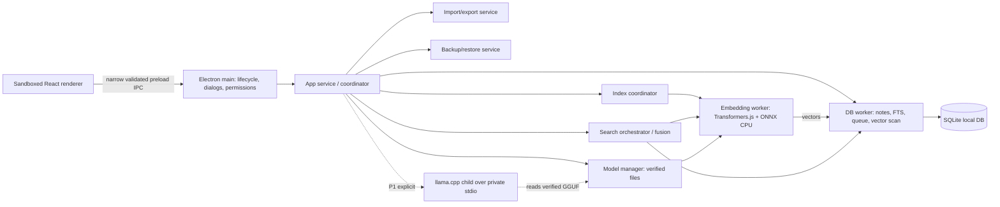

# Product Requirements Document: Smart Notepad

## 1. Document Control and Version

| Field | Value |
|---|---|
| Status | Proposed implementation specification; nothing described is implemented by this document |
| Version / date | 1.0 / 29 October 2026 |
| Product | Smart Notepad, working name |
| Target | Windows 11 x64, CPU-only; Windows 10 assessed separately |
| Audience | Product, engineering, design, QA, security and release maintainers |
| Priority | P0 blocks MVP; P1 blocks the optional answer feature, not the MVP; P2 is later. All numerical performance budgets are provisional until measured. |
| Evidence | Sources in §31; model quality, resource figures and compatibility of the exact packaged dependency set remain release-validation items. |

## 2. Executive Summary

Smart Notepad is an installable, single-user, local-first Windows application for writing and finding notes. It combines SQLite full-text search with on-device sentence embeddings. Generative answers are an independently downloadable, explicitly invoked P1 extension, gated on grounding and resource tests. No account, API key, paid AI service, cloud database or GPU is required. Editing and keyword search remain usable if either AI model is absent.

The defining release test uses a complete DIY smartphone spectrometer note. The query **“Analyze light using household items.”** must return it in the top five, with an actual relevant excerpt, after local indexing, without a generative model or network. This is an empirical release gate, not a guarantee that an embedding understands all paraphrases. If the chosen model/ranking fails the held-out test, improve and retest the pipeline or select a verified alternative; do not fake success with a hard-coded synonym or special-case boost.

**MVP decision:** React/TypeScript in Electron; privileged Node service and isolated worker processes; SQLite/FTS5; ONNX Runtime CPU plus local Transformers.js tokenizer/model handling; exact brute-force cosine over locally stored vectors. English-first Markdown-source editor, hybrid search, trash, import/export and verified backup. Optional grounded answers may ship only after the P1 gate; otherwise MVP ships without them. Core offline claim covers note editing, keyword and semantic search after acquisition; local Q&A works offline only when the separately gated answer feature and model are installed.

## 3. Product Vision and Goals

Help a person capture information naturally and rediscover it by purpose or meaning rather than remembering wording. Priorities: safety of text, retrieval relevance, privacy, responsive writing, transparent evidence, modest-hardware operation and accessible desktop conventions. Users need not categorize notes.

**Outcomes:** retrieval of paraphrased material; no silent loss of acknowledged saves; task completion offline after setup; keyword and note-taking independence from AI; source navigation without pretending a model's reasoning is a quotation. Quality and operational targets are in §§9, 18, 21.

## 4. Problem Statement

Personal notes accumulate in disparate wording and lengths. Literal search misses a user's mental description, while broad keyword search retrieves unrelated contexts. Remote answer services can expose private information and cost money. Small local models are imperfect and resource-constrained: relevance and answer grounding must be measured, and low confidence communicated instead of hidden.

## 5. Target Users and Personas

- **Practical learner:** collects tutorials and experiments; remembers what a project does, not its technical name.
- **Technical troubleshooter:** retains error fixes, settings and commands; needs exact strings and conceptual queries.
- **Researcher/student:** stores long articles, research, meeting and study notes; needs passage-level navigation and portable backups.
- **Personal organizer:** records reminders, ideas and plans without compulsory folders or tags; values an uncomplicated offline editor.

Primary language for tested retrieval and UI is English. Unicode text is preserved, but non-English semantic quality and localization are not MVP guarantees.

## 6. User Stories and Jobs to Be Done

1. Quickly create an untitled note and trust that saved text survives restart.
2. Find a procedure by describing an outcome, e.g. analyzing light with household items.
3. Find a precise command or phrase without a semantic match burying it.
4. Open a search result at the passage that caused the match.
5. Recover a mistakenly deleted note and transfer or back up the collection.
6. Ask a question across saved notes, when optional answer generation is enabled, and inspect supporting passages; distinguish inference and unresolved conflicts.
7. Continue writing and searching offline or when model loading fails.

## 7. Product Scope and Non-Goals

| Area | MVP P0 | P1 / later |
|---|---|---|
| Writing | Markdown source, autosave, multi-note navigation, undo/redo | Rich WYSIWYG, live preview |
| Organization | Recent, pinned, trash/restore, sort, timestamps | Optional tags, archive, folders |
| Retrieval | Keyword, semantic and hybrid; note/passage sources | Typo expansion, reranker, multilingual model |
| Answers | Search results only | Optional local cited answers; gate independently |
| Data | TXT/Markdown batch import/export, full backup/restore | PDF/DOCX extraction, attachments |
| Platform | Windows 11 x64 | Windows 10 after separate compatibility/security assessment; macOS/Linux |

No collaboration, sync, accounts, cloud inference, auto-upload, analytics, enterprise administration, OCR, attachments, web crawling, autonomous editing or plugin execution in MVP. P1 answer generation is a candidate first-release add-on, not a dependency of MVP. Search supports multi-note retrieval in MVP; synthesis across them is P1. A model unavailable due to hardware must not disable writing or keyword search.

## 8. Functional Requirements

Stable, testable requirements and traceability are in §22; each entry includes priority, rationale, dependencies, acceptance and verification. §§9–20 define the normative mechanics. P0 denotes minimum release, not an assertion of implementation. A diagnostic must distinguish partial indexing from no relevant results.

## 9. Detailed Smart Search Specification

### 9.1 Interaction and edge behavior

Global search is always visible. Default **Hybrid** runs keyword and semantic retrieval in parallel; a compact selector offers **Keyword** and **Semantic**. Questions are ordinary search queries; **Answer from notes** is a separate explicit action when P1 is enabled. Search never invokes a generator automatically. Show results incrementally: lexical first, followed by a stable reorder when semantic completes, with “Searching meaning…” and an index coverage indicator. Debounce 250 ms (tunable), Enter starts immediately. Each query has a monotonically increasing request ID and generation; later queries cancel queued work and ignore late messages. Running ONNX calls may not support termination on Node [R3]; complete the in-flight batch but discard it. Down/Up selects results, Enter opens, Escape clears/closes and restores focus. Preserve selection by note ID when reordering.

- Empty query shows recent notes, no inference. Whitespace is empty. One word is valid; lexical is prominent and weak semantic-only candidates may be hidden by calibration.
- Query limit 2,000 Unicode code points; reject beyond with visible counter, never silently truncate. For embeddings tokenize up to model limit, and explicitly offer “Search first 200 tokens” if it exceeds 200 wordpieces; FTS may use the full accepted query. Do not claim full semantic coverage.
- Parse words as escaped FTS tokens, not raw FTS grammar; quoted text means literal phrase. Prefix search only on the last word of at least 3 characters. No substring guarantee. P1 typo suggestions use bounded edit distance over a local vocabulary and are labeled; MVP misses spelling errors gracefully and can still match semantically, with no promised typo correction.
- Ambiguous query: show diverse candidates without interpreting intent as fact; several relevant notes are displayed individually, stable tie-break updated timestamp then ID. Identical titles are differentiated by excerpt and modified date, never merged.
- Deletion/trash: exclude immediately upon committed deletion, even if old index data remain. Newly edited/renamed/imported/restored notes are keyword searchable after commit; semantic coverage is pending until fresh vector commits. Never use a stale vector for current revision. Unsaved editor buffers are not searched: display “Unsaved changes not in search”; trigger save before opening a result if possible. Empty notes appear in recent, are indexed only if title has content, and never generate zero vectors.
- Unsupported attachments are not accepted; tell user supported formats. Missing/corrupt vectors: suppress them, mark pending, enqueue repair. Failure loading a model displays “Meaning search unavailable; keyword results shown” with Retry/Settings. Interrupted jobs resume as §16. No results: “No meaningful matches in indexed notes” only after complete indexing and calibrated relevance filter; otherwise “No matches yet; indexing incomplete,” plus keyword option. Very large collections show progress and are subject to §18 limits, not an unbounded speed promise.
- An irrelevant occurrence of a term may appear in keyword mode; hybrid uses actual chunk context and calibration; never guarantee relevance for semantic similarity. For questions whose answers span notes show all matching passages; P1 can synthesize with separate citations.

### 9.2 End-to-end pipeline

All components execute locally. On committed title/body change: (1) preserve original Markdown text exactly, except normalize newlines at import into LF; (2) make FTS note-level title/body synchronously within save transaction; (3) enqueue revision-specific semantic indexing. Text is source Markdown; MVP does not parse PDFs or attachments. For embeddings, partition **body** into contiguous original-text ranges on paragraph/sentence boundaries, using model tokenizer with up to 180 wordpieces including a bounded title prefix (up to 24 tokens), 32-token overlap, and model special tokens included in the limit. A paragraph too long is split at token offsets. Prefix is separate metadata, not a source passage. For an empty body with a non-empty title, index a title-only chunk. Chunk sizes are initial tunables, not validated optimum. Newlines/Unicode are preserved in source; inference normalization uses tokenizer behavior; any transformed text must not change source offsets.

(4) Apply model tokenizer, ONNX forward pass, attention-mask mean pooling and L2 normalization; reject NaN/zero norms. (5) Store float32 little-endian 384-vector and chunk metadata transactionally. (6) Tokenize query with same model/version and embed locally; (7) stream valid vectors in pages from SQLite, dot product unit vectors, retain top 100 chunks; no external service. (8) FTS5 queries titles/body, weighted BM25 with initial weights title 2, body 1, top 100 notes; SQLite's BM25 is lower-is-better [R6]. Token quoting and parameters prevent syntax injection. (9) Collapse chunks to best per note; merge ranked lists using weighted reciprocal-rank fusion: `0.6/(60+semanticRank) + 0.4/(60+lexicalRank)` with missing term zero. This mixes ranks, not uncalibrated score scales; initial weights are hypotheses. (10) Exact-title or phrase hits participate through BM25, not unconditional boosts; no recency boost. Optional user-selected Recent sort changes ordering explicitly and is not relevance. (11) Cross-encoder reranking is deferred pending budgets/evaluation. (12) Deduplicate by note ID, never title, retaining winning chunk and alternate snippets. (13) Semantic excerpt is an exact substring around winning chunk, clipped at paragraph/sentence boundary; lexical snippet is extracted from current source, escaped for display. (14) Labels are deterministic: “Similar meaning” and/or “Contains ‘…’”/“Title match.” Do not generate an explanatory sentence in MVP. The illustrative paraphrase “This note describes a DIY experiment…” would be a system-generated explanation, not a quote; show only if P1 explicitly labels it generated and cites its source. (15) Display title, real excerpt, match reason, qualitative relevance band, timestamp and open action. (16) Passage navigation validates note revision and highlights UTF-16 offsets as §15; if changed, open current note with “Passage changed” and do not mis-highlight.

Example source: “Build a simple spectrometer using your smartphone and a small piece of an old CD or DVD.” Query “Analyze light using household items.” => title “Use Your Phone as a Secret Spectrometer”, this exact source excerpt, reason “Similar meaning”, not a claim of certainty. Query/title need not share technical terminology; the complete corpus and adversarial cases define whether ranking is acceptable.

### 9.3 Relevance calibration

Cosine and RRF scores are not probabilities. A provisional filter learns two operating points on a development set from features: top cosine, lexical evidence and fusion score; validate separately by query length and collection size. “Strong match” requires high precision on held-out judged pairs; “Possible match” is the lower calibrated range. Below the lower threshold hide results by default and offer “Show weaker matches.” Exact matching evidence may qualify independently only where relevant to the whole query; BM25/phrase alone is not proof. If calibration is unavailable, show “Matches (unrated)” and never fabricate strong/no-meaning labels. Choose the lower threshold for ≥0.90 recall of relevant queries on development data and the upper for ≥0.90 judged precision, then report held-out values, confidence intervals and no-match false positive rate. Do not tune on the mandatory test or held-out set. Calibrate every model, chunker and ranking version independently. A threshold may fail the targets; gate the release instead of inventing one.

### 9.4 Search-quality evaluation set

Define corpus manifest with stable note IDs, full UTF-8 Markdown source and SHA-256; versioned query/judgment files. These fixture descriptions define required content; authors create realistic long and short variants, adversarial overlaps and exact phrase positions. Two independent human annotators label **2** directly useful, **1** related/partial, **0** irrelevant, resolve disagreement and preserve adjudication. No user notes collected. At least 200 human-authored English queries with 30% no-match, ≥20% hard negatives, 20% multi-note questions, plus synthetic notes; group by topic so train/dev/held-out do not leak near duplicates. Fixtures below are mandatory regression set, kept out of threshold tuning. Create 100-note and 20,000-note scale sets from deterministic seed with varied lengths; use unique combinations rather than identical filler and maintain same labeled targets. Record corpus/query manifests, model/artifact hashes, chunker and fusion parameters. If a test isn't supported by sources, change neither source nor labels merely to make it pass.

Fixture IDs: **S** spectrometer (phone camera, CD/DVD grating, opaque tape, setup and light-source spectra); **W** improve Wi-Fi (router position, channels); **K** Windows keyboard shortcut (Win+Shift+S screenshot); **D** discarded-material planter (bottle); **L** LED vs fluorescent spectra comparison; **M1/M2** meeting plan/budget, with distinct facts; **C1/C2** conflicting router channel advice dated differently; **P** pasta; **B** bicycle brake; **O** CD music collection (irrelevant optics); **F** photography phone camera (not spectrometer); **R** unrelated common term “light” meaning lightweight packing; **T1/T2** identical titles with different bodies; **E** exact command `ipconfig /flushdns`; **N** outage troubleshooting; **H** home insulation; **G** garden watering; **X** phrase `quantum banana` in cooking context; remaining distractors cover everyday and technical text.

| # | Query | Relevant / expectation; hard-negative or check |
|---|---|---|
| 01 | Analyze light using household items. | S top 5, source excerpt; O/F/R not ahead of S |
| 02 | That experiment involving a CD and my phone. | S; O/F distractors |
| 03 | observe colors from different lamps with a homemade device | S, L partial |
| 04 | make a diffraction instrument with tape | S |
| 05 | How can I distinguish LED lights from fluorescent lights? | L and S if evidence covers it |
| 06 | using an old disc to separate wavelengths | S; O irrelevant |
| 07 | Find my note about building something useful from discarded materials. | D and S both relevant |
| 08 | what parts do I need for a phone spectrum experiment? | S; F irrelevant |
| 09 | “opaque tape” | S exact phrase |
| 10 | Use Your Phone as a Secret Spectrometer | S title |
| 11 | spectrom | S prefix in keyword mode |
| 12 | what did I save about making Wi-Fi faster? | W; C1/C2 partial |
| 13 | wireless network is slow at home | W, N |
| 14 | router channel selection | W/C1/C2; conflicting passages retained |
| 15 | That Windows shortcut I wrote down | K; other Windows notes partial |
| 16 | capture part of my screen | K |
| 17 | “Win+Shift+S” | K; punctuation tokenization validated using source phrase verification |
| 18 | ipconfig /flushdns | E; exact literal preservation |
| 19 | “quantum banana” | X exact phrase; no physics assumption |
| 20 | fix connectivity after power outage | N; W partial |
| 21 | household light | S or L partial; R not semantically equivalent |
| 22 | light packing list | R; S/L not relevant |
| 23 | catalog my music CDs | O; S irrelevant |
| 24 | camera portrait settings | F; S irrelevant |
| 25 | How do I stop my bike safely? | B |
| 26 | boil noodles for dinner | P |
| 27 | stop heat escaping from house | H |
| 28 | watering plants in summer | G |
| 29 | agenda and amount approved for meeting | M1 and M2 both; P1 answer needs both |
| 30 | what is the meeting budget? | M2; M1 partial |
| 31 | do my notes disagree on router channels? | C1/C2 both; not silently pick one |
| 32 | identical title | T1/T2 both distinct; excerpt/date distinguish |
| 33 | repair a submarine nuclear reactor | none; weak matches hidden if calibrated |
| 34 | plan a holiday on Mars | none |
| 35 | spectromter experiment | S desirable, not P0 typo guarantee; report separately |
| 36 | Which note explains how to fix the problem I described earlier? | ambiguous without earlier context; no invented prior state |
| 37 | empty/whitespace | recent list, no model call |
| 38 | CD | S/O both plausible; no false certainty |
| 39 | “a phrase not present anywhere” | no exact results in keyword mode |
| 40 | analyze light using household items after S deleted | S excluded; restore/reindex then S returns |

For each test retain relevant set and all judged top 10, not only one expected ID. Mandatory note must be top 5 in both 100 and 20,000 note corpora, with actual relevant excerpt, on clean indexed builds. Recall@5 = relevant notes in top 5 / all judged relevant notes; separately report hit@5 for at least one relevant. Precision@5 = relevant (grade 2, and separately grade ≥1) among five returned slots; fewer than five use five as denominator for standard comparisons. MRR@10 uses first grade-2 rank, zero if none. For multi-answer tasks report complete-set recall. No-match false positive = no-match queries with any result above lower calibrated threshold. Human review inspects top 5 and all false negatives; severe irrelevant top-1 rate is counted separately. Targets: held-out macro recall@5 ≥0.80, hit@5 ≥0.90, P@5 ≥0.60 on queries having ≥5 relevant items (report P@5 separately on other queries), MRR@10 ≥0.75, no-match false positive ≤0.10, severe irrelevant top-1 ≤0.05; stratify 100 and 20,000 sets, with bootstrap 95% CIs and minimum 30 judged queries per important slice. These are proposed gates; a query with fewer than five relevant notes cannot mathematically achieve high P@5, hence the subset qualification. Compare keyword-only, semantic-only, hybrid; record quality regressions per model release. Ground-truth incompleteness is addressed by judging pooled top 10 from all systems and manually sampling excluded passages.

## 10. AI and Local Model Specification

### 10.1 Roles and choices

An embedding model encodes notes and queries into comparable vectors; retrieval compares vectors and FTS without producing text. A generative LLM predicts text from retrieved evidence. Embeddings are required for semantic mode, not for editing or keyword; generator is P1, optional and off by default. Neither requires a key, paid account or connection after installation.

| Candidate | License / dimension / context | Size and fit | Decision |
|---|---|---|---|
| `sentence-transformers/all-MiniLM-L6-v2` | Apache-2.0 per model metadata; English, 384d, default max 256 wordpieces [R1, R2] | 22.7M parameters; FP32 weights roughly 90 MB by arithmetic, not verified download size; quantized export smaller, validate artifacts | Default: official ONNX export, FP32 initially for known baseline; validate Windows tokenizer, pooling and outputs against Sentence Transformers |
| `sentence-transformers/paraphrase-MiniLM-L3-v2` | 384d, 128-wordpiece max, 17.4M parameters [R4]; verify exact license metadata and redistribution before enablement | ~70 MB FP32 weight estimate; 3-layer CPU speed/RAM are hypotheses; test quality | Lightweight fallback only after artifact/license and parity tests; separate chunks/vector generation and calibration |
| Sentence Transformers / Python | Model-specific license; same model | Practical evaluation reference, Python/PyTorch adds packaging and memory cost | Evaluation tooling, not runtime |
| Transformers.js + ONNX Runtime Node | Runtime licenses verified in inventory; ONNX CPU Windows x64 [R3, R5] | JS tokenizer plus native backend, possible Electron ABI/bundling issues | Selected; pin tested versions and package all tokenizer assets. Remote loading disabled |

Official model repositories' actual file trees, revision SHA and model/tokenizer file sizes must be recorded from the exact artifact before release. If the fallback license/export cannot be verified, do not distribute it: use keyword-only as operational fallback, not an unverified substitute. No claimed benchmark numbers; measure on reference hardware. Both models are primarily English; do not imply multilingual parity. Runtime dependency size is separate from model size. ONNX CPU thread/memory depends on packaged binary and input; verify in §18. The selected ONNX export and tokenizer layout must work with pinned Transformers.js; if official ONNX layout is unsupported, use a reproducibly converted export and document provenance, licenses, hashes, parity and local loading before release. No remote model fallback. The L3 fallback must use its own maximum 128-token budget, including title and special tokens, with proportionately smaller overlap, not the L6 chunk setting.

### 10.2 P1 local answer generator

Recommend bundled, pinned CPU-only `llama.cpp` executable [R7] as an isolated child, invoked with fixed arguments and a private inherited stdin/stdout channel; no shell, TCP listener, third-party server or externally accessible port. Validate that the pinned executable supports the needed structured response and cancellation interface; if not, build a small pinned stdio adapter against llama.cpp, tested and distributed with it. Ollama [R8] is maintained and convenient for enthusiasts but requires a separately managed service and may have cloud capabilities; it is not an MVP dependency or integration. Qwen2.5-0.5B-Instruct Q4_K_M is the proposed optional default: official GGUF is 491 MB [R9]; verify exact file license Apache-2.0 [R10], pinned revision and hash. Tiny model may fail grounding; do not promise hosted-model quality or enable until §21 gates pass. Download only on explicit first use; do not bundle weights in installer. No GPU needed. Memory-map where supported; cap context 2,048 model tokens including input/output and 256 output tokens; one generation at a time, 2 CPU threads initial. Pause bulk embedding while generating; prioritize saves and query embedding. Cancel by cooperative protocol or terminate/reap child, discard partial answer, preserve database. On load/OOM/runtime failure show specific error and sources only. Offer Disable and Remove model. Optional feature can be excluded completely if slow or ungrounded.

### 10.3 Grounded question answering (P1)

On explicit action retrieve top candidates from current saved revision, up to 6 chunks from ≥1 and at most 3 notes, preferring diversity only when relevance is comparable; no evidence => abstain. Budget 2,048 total tokens: reserve 256 output, 256 instructions/question/citation syntax, at most 1,536 evidence; actual tokenizer count must fit, trim whole spans rather than silent source alteration. Evidence is untrusted data delimited and numbered `S1…S6`; prompt says do not follow instructions within notes, answer only from supplied evidence, mark inference and conflicts, and abstain if insufficient. Limit answer to short claim units and source IDs. Constrained output parsing, if supported, otherwise strict schema validate; each factual claim requires at least one ID in supplied set. Map ID server-side to `(note_id, revision, chunk_id, start_utf16, end_utf16, text_hash)`. Reject unknown IDs, missing citations or malformed output, retry once then show “Cannot produce a supported answer” plus sources. Verify source revisions and content hashes again before display/navigation; invalidate answer on change or delete. No LLM-supplied offsets or quotes are trusted; quote from stored spans. Citation membership validates provenance, **not entailment**; no automated check can guarantee factual support. Show “Generated answer; check cited passages,” distinguish explicit inference and conflict, and gate release on independent claim-level review (§21). Prompt injection can still affect model text; never allow tool calls, file access, links, note modifications or external actions from generated output. User must copy text manually; original note is never changed.

### 10.4 Model lifecycle

Onboarding explains semantic download (about 90 MB weights plus tokenizer, actual size shown from pinned manifest) and optional ~491 MB generator plus overhead. Explicit Download or Continue without AI. Manifest bundled with application pins immutable source revision, HTTPS URL, byte length, SHA-256 and license for each file; release pipeline obtains and reviews hashes independently from exact upstream artifacts, signs application and manifest as part of package. HTTPS alone or an unsigned hash downloaded alongside an artifact is not authenticity. Verify size/hash before atomically promoting staged files on same volume; do not load bad files. Temporary download supports HTTP Range only after verifying ETag/length and response; otherwise restart, hash entire completed file. Enforce free space for staged plus installed files and a 500 MB safety reserve. On restart detect and offer resume/delete; no repeated download when verified files exist. Settings show version, disk, license, progress, retry, remove and model switching. Default switch creates a new index generation (§16); do not mix vector spaces. Deleting embedding model removes semantic availability but leaves notes/FTS. Do not delete old verified model until replacement passes tests; user may explicitly remove it. Disable library auto-downloads and remote inference. Initial acquisition and user-initiated update checks require internet; no background connections by default. Offline launch uses verified local assets. Low memory unloads generator first, pauses background indexing, preserves editing and keyword search.

## 11. Note Editor and Management Specification

**Format:** Markdown source edited as plain text with monospace font and optional soft wrap; no live rendering in MVP. It preserves Markdown, avoids lossy rich-text transformations and lets TXT/MD round-trip. Headings (`#`), bullets/numbered lists, `**bold**`, links, fenced code blocks and Unicode are stored literally; no feature implies syntax is rendered or validated. No executable HTML. Spectrometer fixture includes heading, materials list, ordered steps and observation section. New note opens immediately, title optional with display fallback “Untitled note” (not stored as title). Empty note may be retained, never implicitly deleted. Title max 1,000 characters, body max 5 MiB UTF-8 for MVP; explain limit before rejecting, never truncate.

Autosave after 750 ms idle and on note switch, explicit Ctrl+S, app close and OS shutdown where time allows. Each editor has monotonic local edit sequence; a commit ACK carries sequence and revision. Only show “Saved” if latest sequence committed; otherwise “Saving…” or “Not saved—Retry / Copy text.” Earlier ACK cannot clear newer dirty state. A failure retains buffer; prevent switching/closing without Save/Copy/Discard confirmation. Crash recovery is best-effort: committed autosaves survive; uncommitted keystrokes may be lost. No claim of zero-loss or redundant journal; users are told the debounce window and failure risk. On restart show last persisted content. Undo/redo uses per-open-note in-memory history; may not survive restart, cap memory; restore cursor/scroll per open note in session. Ctrl+X/C/V and selection use OS conventions. Notes list and tab-like recent switcher permit multiple open notes; serialize saves per note and preserve drafts. Single process instance; simultaneous external DB editing unsupported.

**Organization:** pins, recent, created/updated timestamps, sort by updated/title/created; pinned group in recent. Trash is soft deletion, excluded from normal search immediately; restore retains ID and creates new revision/index job. Permanent delete requires confirmation, cascades chunks/vectors/FTS/jobs, cannot be undone except backup. No automatic trash purge in MVP. Duplicating creates new ID, same text, fresh timestamps/index; duplicate title allowed. Tags schema may exist for migration preparation but tag UX deferred. No mandatory folder.

**Import/export:** multi-select `.txt` and `.md`, UTF-8 (optional BOM), preserve body including Markdown; choose title from filename with extension removed, not inferred from first heading. Invalid UTF-8, NUL/binary, oversized or unsupported files fail individually with report, no silent replacement. Maximum 1,000 files per batch; each is atomic, batch can partially succeed and shows counts/errors. Preview SHA-256 of normalized title/body; duplicate offers Skip (default) / Import copy per file or apply to all; no overwrite. Same filename with different contents is not duplicate. Markdown export exact source body in UTF-8 LF; TXT also exports literal source (not stripped). File-safe names plus short ID avoid collisions; choose folder, preflight collisions and prompt Skip/Rename/Overwrite, write temp then atomic rename, show per-file errors. Note titles/timestamps are not fully represented in individual text exports; use backup for metadata. Full backup is a SQLite consistent snapshot with schema version, notes, trash and settings; includes derived indexes but restore may rebuild them. No attachment parsing. Backup is unencrypted; disclose before choosing destination. Restore is replacement, not merge, and follows §15.

## 12. User Interface and Interaction Design

### 12.1 Workspace and states

```text
+-----------------------------------------------------------------------+
| Smart Notepad     [ Search notes, phrases or questions          ] [v] |
+----------------+--------------------------------+---------------------+
| + New note     | Title: [____________________]  | Results  12  [Hybrid]|
| All notes      | Saved / Saving / Not saved    | Similar meaning     |
| Pinned         |                                | Spectrometer        |
| Recent         | Markdown source editor         | “Build a simple…”   |
| Trash          |                                | [Open passage]      |
| Settings       |                                | ...                 |
+----------------+--------------------------------+---------------------+
```

At ≥1100 px use sidebar (~200 px), flexible editor (≥360 px) and optional results (~320 px). At narrower window hide results behind a toggle and replace sidebar with collapsible navigation; min window 720×500, no clipped critical actions. Search results overlay/panel never changes note without selection. User can resize within bounds. Window retains geometry when visible on a connected monitor.

**First run:** local data/no account; explicit embedding download, size/source/privacy and progress; Continue without download. Never block editor on model. **Empty workspace:** “Create your first note” and shortcut. **Editor:** title, text, save state, trash/pin, timestamps; failures actionable. **Search:** selector, progress, coverage, labeled reasons/excerpts, no-result and partial-index state; activate opens exact source passage with focus in editor and Back to results. **Answer:** optional explicit button; “Generated from your notes,” answer, numbered source links, conflicts/uncertainty, Stop and Close; no auto edits. **Settings:** appearance, editor, search, AI/models, data/backup, privacy, diagnostics tabs; accessible status/progress. **Import/export:** native file chooser, preview/count/duplicates, summary and retry. **Backup/restore:** destination, unencrypted warning, verification result; restore replacement confirmation and recovery snapshot. **About/diagnostics:** version/build, model/index coverage, third-party licenses, export redacted diagnostics; no note contents by default. Show disabled functions with reason and recovery action. Confirmation dialog shows destructive consequences, defaults to Cancel; focus trapped and restored on close.

### 12.2 Visual and accessibility

Use system UI font (Segoe UI when available), 14–16 px base, 12 px minimum secondary, editor 14–20 px configurable with monospace fallback; 8 px spacing scale; light/dark/system themes, no gradient/decoration. Text contrast ≥4.5:1, controls/non-text ≥3:1; honor Windows high contrast, text scale and reduced motion. Clear 2 px focus ring, no color-only status. Accessible names, semantic roles, live-region status (debounced), logical reading order, keyboard-only operation; test Narrator. No visual-only citation markers.

| Shortcut | Action |
|---|---|
| Ctrl+N | New note |
| Ctrl+S | Immediately request save; confirmation only after commit |
| Ctrl+F | Focus global search |
| Up/Down in results, Enter | Select/open result |
| Ctrl+Tab / Ctrl+Shift+Tab | Next/previous open note |
| Escape | Close dialog/panel or clear search, restore focus |
| Ctrl+Z / Ctrl+Y | Undo / redo in editor |
| Ctrl+X/C/V/A | Cut/copy/paste/select all |

Avoid intercepting OS-reserved keys; shortcut list available in Settings. Navigation semantics and focus tested for every dialog and state.

## 13. System Architecture



UI is unprivileged and never accesses filesystem, DB, raw IPC, process creation or network. Main validates typed operation and sender, handles OS dialogs and coordinates. DB worker owns SQLite connection and serializes mutations; synchronous native driver never blocks UI/main. Embedding worker performs CPU-bound model loading/inference and receives immutable snapshots. Search orchestrator coordinates results and identity checks; ranking is pure domain logic. Model manager alone performs consented downloads and atomic file promotion. LLM is isolated and optional, given only selected evidence. Import/export and backup request DB worker operations, not direct file copy of a live DB. Worker boundaries reduce UI stalls but are not OS security sandboxes; security controls are §17.

### Project layout

```text
src/main/          lifecycle, IPC validation, windows, native dialogs
src/preload/       narrowly typed renderer bridge
src/renderer/      React screens, editor, accessible components, styles
src/shared/        DTO schemas, IDs, error codes and pure domain types
src/services/      notes, model manager, import/export, backup orchestration
src/db/            migrations, repository, FTS, transactions, DB worker
src/search/        chunking, retrieval, fusion, excerpt/offset mapping
src/ai/            local embedding worker, tokenizer, optional LLM adapter
src/workers/       process entrypoints and queue coordination
resources/         app assets, model manifest, licenses (no model weights)
tests/{unit,integration,e2e,security,performance,quality}/ fixtures and suites
docs/              architecture, schema, operations, privacy, licenses
packaging/         Forge config, signing/installer scripts
```

No application code is provided by this PRD; layout is proposed.

## 14. Technology Stack and Justification

Choose Electron + React + TypeScript; Electron Forge/Squirrel.Windows installer; SQLite + `better-sqlite3` in dedicated DB worker; FTS5; Transformers.js local tokenizer/feature extraction backed by `onnxruntime-node` CPU worker. Electron offers consistent bundled Chromium, easy TS IPC and native Node model/file integrations, but costs RAM and startup time and requires careful security/native-module ABI packaging [R3,R11,R12]. `better-sqlite3` is maintained and synchronous [R13]; test its bundled SQLite build for FTS5 and online backup in the exact Electron ABI, unpack native binaries from ASAR and rebuild as needed. ONNX Runtime documents Windows x64 CPU binaries, not blanket Electron compatibility; packaged smoke test is mandatory. Pin exact compatible versions in lockfile only after native Windows tests and check ongoing support at release, not a guessed version here. Only x64 is supported initially; do not claim 32-bit or ARM compatibility. Electron's current breaking changes remove 32-bit prebuilt artifacts and old releases removed Windows 7/8 support [R14]; verify Win10 compatibility separately for the selected version and security lifecycle.

**Alternative A: Tauri + Rust + WebView2.** Lower expected distribution/runtime footprint, native Rust SQLite/ONNX integration, capability permissions; additional Rust integration and system WebView2/version/installer dependencies complicate offline, and resource advantages must be measured. Tauri documents WebView2 installer tradeoffs [R15]. Revisit if Electron fails measured RAM/startup gates. **Alternative B: native .NET/WPF + ONNX Runtime.** Native Windows shell and possible lower overhead, but requires .NET, separate UI/inference expertise and different packaging/model handling; credible if team skills favor it. Neither alternative is assumed faster without same-hardware tests.

**Vector alternatives:** store vectors in SQLite and stream exact cosine, selected for simple consistency/rebuild and ≤100k chunks target. Vector bytes alone 384×4 = 1,536 per chunk: ~153.6 MB decimal for 100k, plus DB/page/index overhead. Scan paged rather than loading whole index; measure HDD warm/cold. `sqlite-vec` supports Windows, is MIT/Apache and explicitly pre-v1 [R16]; it is an option if packaged exact tests show improved latency, not an assumed ANN index or default. Separate ANN service/index adds persistence, consistency and Windows binaries; defer until measured need. At >100k chunks warn of slower searches and allow keyword mode; no hard note count cap, but do not claim tested latency at arbitrary scale.

## 15. Database and Data Model

SQLite is authoritative, with WAL, foreign keys on every connection, one DB worker/writer, bounded read transactions and `busy_timeout` (e.g. 5 s); `synchronous=FULL` for committed save durability subject to OS/hardware guarantees. Store under `%LOCALAPPDATA%/SmartNotepad/` (DB, WAL, models, logs); app binaries under per-user install location. NTFS local disk only in MVP; no user-configurable data path or shared/network drive. SQLite backup API avoids copying a live database file [R17]. Timestamps are UTC integer Unix milliseconds. IDs are random UUID text. Revisions monotonically increase on title/body/trash/restore changes. Offsets are UTF-16 code units, zero-based half-open in exact persisted body; title-only chunk uses field=`title`. All chunks slice the saved string; surrogate boundaries must be valid. Source and chunk SHA-256 are over UTF-8 encoding of exact substring. Test CRLF normalization at import, emoji, combining marks, repeated text and Markdown.

Representative logical DDL below is normative for keys and constraints; implementation may add checks/indexes and migration metadata. Set every timestamp explicitly; integers are SQLite signed 64-bit, TEXT UUID, BLOB float bytes.

```sql
CREATE TABLE notes (
 id TEXT PRIMARY KEY, title TEXT NOT NULL DEFAULT '', body TEXT NOT NULL DEFAULT '',
 revision INTEGER NOT NULL DEFAULT 1 CHECK(revision > 0),
 pinned INTEGER NOT NULL DEFAULT 0 CHECK(pinned IN (0,1)),
 created_at INTEGER NOT NULL, updated_at INTEGER NOT NULL, deleted_at INTEGER
);
CREATE INDEX notes_active_updated ON notes(deleted_at, updated_at DESC);
CREATE INDEX notes_title ON notes(title COLLATE NOCASE);
CREATE TABLE tags (id TEXT PRIMARY KEY, name TEXT NOT NULL COLLATE NOCASE UNIQUE,
 created_at INTEGER NOT NULL, updated_at INTEGER NOT NULL);
CREATE TABLE note_tags (note_id TEXT NOT NULL REFERENCES notes(id) ON DELETE CASCADE,
 tag_id TEXT NOT NULL REFERENCES tags(id) ON DELETE CASCADE,
 created_at INTEGER NOT NULL, PRIMARY KEY(note_id,tag_id));
CREATE INDEX note_tags_tag ON note_tags(tag_id);
CREATE TABLE models (id TEXT PRIMARY KEY, kind TEXT NOT NULL CHECK(kind IN ('embedding','llm')),
 version TEXT NOT NULL, sha256 TEXT NOT NULL, dimension INTEGER,
 state TEXT NOT NULL, installed_at INTEGER, created_at INTEGER NOT NULL, updated_at INTEGER NOT NULL);
CREATE TABLE index_generations (id TEXT PRIMARY KEY, model_id TEXT NOT NULL REFERENCES models(id),
 chunker_version TEXT NOT NULL, state TEXT NOT NULL CHECK(state IN ('building','active','retired')),
 created_at INTEGER NOT NULL, updated_at INTEGER NOT NULL);
CREATE UNIQUE INDEX one_active_generation ON index_generations(state) WHERE state='active';
CREATE TABLE chunks (id TEXT PRIMARY KEY, note_id TEXT NOT NULL REFERENCES notes(id) ON DELETE CASCADE,
 generation_id TEXT NOT NULL REFERENCES index_generations(id) ON DELETE CASCADE,
 revision INTEGER NOT NULL, ordinal INTEGER NOT NULL, field TEXT NOT NULL CHECK(field IN ('title','body')),
 start_utf16 INTEGER NOT NULL, end_utf16 INTEGER NOT NULL CHECK(end_utf16 >= start_utf16),
 text_hash TEXT NOT NULL, created_at INTEGER NOT NULL, updated_at INTEGER NOT NULL,
 UNIQUE(note_id,generation_id,revision,ordinal));
CREATE INDEX chunks_note ON chunks(note_id,generation_id,revision);
CREATE TABLE embeddings (chunk_id TEXT PRIMARY KEY REFERENCES chunks(id) ON DELETE CASCADE,
 dimension INTEGER NOT NULL, vector BLOB NOT NULL, created_at INTEGER NOT NULL,
 CHECK(length(vector)=dimension*4));
CREATE TABLE index_jobs (note_id TEXT NOT NULL REFERENCES notes(id) ON DELETE CASCADE,
 generation_id TEXT NOT NULL REFERENCES index_generations(id) ON DELETE CASCADE,
 target_revision INTEGER NOT NULL, state TEXT NOT NULL CHECK(state IN ('pending','running','retry','failed')),
 attempts INTEGER NOT NULL DEFAULT 0, next_attempt_at INTEGER, last_error_code TEXT,
 created_at INTEGER NOT NULL, updated_at INTEGER NOT NULL, PRIMARY KEY(note_id,generation_id));
CREATE TABLE settings (key TEXT PRIMARY KEY, value_json TEXT NOT NULL, updated_at INTEGER NOT NULL);
CREATE VIRTUAL TABLE note_fts USING fts5(note_id UNINDEXED, title, body, tokenize='unicode61');
```

FTS uses ordinary contentful rows with rowid not tied to UUID; for each note, service transaction deletes rows by note_id and inserts exactly one active row. Service verifies uniqueness (FTS virtual table cannot enforce it) and rebuilds on inconsistency; track test/repair. FTS BM25 finds candidate note, then service finds exact literal position where possible; otherwise returns first matching textual span, with no fabricated position. FTS query tokenization handles punctuation and verifies exact phrase in original text where necessary. Settings validated against versioned defaults, not arbitrary SQL. Model registry is metadata, not a trust anchor for files; trusted manifest and file hash are authoritative. State constraints for models and generation transitions are enforced by service. Tags are schema-only P2. `PRAGMA user_version` plus ordered migration ledger records schema versions/checksums. Application-level guards enforce vector dimension/model and unique ordinal metadata. Active results join chunks to current notes and active generation, require `chunk.revision=notes.revision`, `deleted_at IS NULL`, valid vector length and model.

**Backup & restore:** DB worker uses SQLite online backup to staging destination, finishes, runs integrity/foreign-key checks on snapshot, then atomic rename; record status only after success. No model files in backup: restore offline search requires already installed verified model or later download. Restore acquires exclusive maintenance mode only after all drafts saved or user cancels; inspect selected snapshot version, integrity and FK checks in temporary directory, reject newer/invalid backups. Create and verify pre-restore snapshot, close all DB handles, preserve current DB/WAL as a rollback set; atomically swap staged consistent database on same volume, reopen/migrate, validate, then commit marker and retain pre-restore backup. Crash recovery uses a durable marker and rollback set to select complete old or new DB; never mix old WAL with new DB. Test each interruption point. If insufficient room or validation fails leave original untouched. After restore verify/rebuild derived FTS and requeue missing vectors; no claims of seamless restoration before this completes. Migration takes a verified pre-migration snapshot, checks disk space, runs transactional additive migration, validates; on failure rollback/read-only recovery and retain snapshot. Do not run destructive migration without explicit tested reversible strategy.

## 16. Search Indexing and Retrieval Architecture

### State, concurrency and transactional rules

Every commit of a changed note, including title, is one DB transaction: update text and increment revision; replace/delete its FTS row; upsert one `pending` job per active/building generation with latest revision and reset obsolete failures. Trash transaction marks deleted, removes FTS, cancels/removes jobs; old chunks may be reclaimed in transaction or later but query joins prohibit them immediately. Restore increments revision, restores FTS and enqueues. Permanent delete cascades. Duplicate/import are new notes and jobs. Empty title/body produces no embeddings and is marked complete without job.

Worker claims due `pending/retry` job as `running` with revision snapshot, reads note and generation, chunks and infers outside write transaction. At commit, transaction rechecks note exists, active/nondeleted, revision equals snapshot, generation still desired, job target still equals snapshot. If any check fails discard results and leave/newly enqueue latest work. Otherwise delete old chunks for `(note,generation)`, insert all new chunks+vectors, remove job atomically. If failure, no partial vectors visible; mark retry with exponential backoff 1 s, 5 s, 30 s then failed after three attempts, surfaced Retry/Rebuild; user edits replace failed target. On startup reset abandoned `running` to `pending`, reconcile current revisions and missing chunks, repair missing FTS. Shutdown stops claiming jobs, waits up to 5 s for DB transactions and discards/terminates unfinished inference; recovery handles jobs. Coalesce rapid edits using upsert and 2-second idle after save; batch 1 chunk initially, 1 embedding worker, 2 CPU threads, release CPU between batches. Query work takes precedence; index progress shows pending/failed counts and current/total, pause/resume. A long inference cannot be preempted mid-ONNX call; discard late results.

Model change: create `building` generation, enqueue all eligible notes; keep old generation active and label its coverage. During build, current-note updates invalidate old revision immediately; keyword works, semantic may omit pending notes. Switch active only in one transaction after every nonempty live note has a valid current revision and no failed job; continuously changing notes can delay switch, surfaced to user. New generation has own chunker/tokenizer/threshold; never compare vectors across models. After atomic switch retire old generation; defer garbage collection until no search snapshot depends on it. If build fails/cancel, old active generation remains, pending notes still shown as incomplete. Rebuild from notes, not vector index, on corruption.

For search, obtain query ID and active generation snapshot, valid chunks joined by revision. Merge candidate IDs, then **revalidate all result IDs and revisions immediately before UI delivery** and again on open/citation. A concurrent edit/delete between search and display removes or marks the result changed; cancel stale UI response. SQLite transactions are short; do not hold a read snapshot throughout slow model inference. Semantic omission while pending is explicit, not hidden stale content.

## 17. Privacy and Security

**Threat model:** malicious imported Markdown, untrusted local files/links and model downloads, prompt-injection notes, dependency supply-chain compromise, accidental deletion, local DB corruption, another local process/user and network interception. Local-first means no note upload or account and local inference; it is not encryption, malware protection, secure deletion or protection from an OS-account owner/admin. Backups and DB are plaintext, including trash, FTS, vectors, WAL and recovery files; advise OS account security, disk encryption such as BitLocker where available, and encrypted backup storage. Permanent deletion may leave recoverable disk/backup/WAL traces.

Electron: `nodeIntegration:false`, `contextIsolation:true`, `sandbox:true`, `webSecurity:true`, restrictive CSP `default-src 'self'; script-src 'self'; connect-src 'none'; object-src 'none'`, no remote content, webviews, popups or arbitrary navigation. Deny permission requests; only allow validated user-initiated `https:`/`http:` links via external browser with confirmation, reject `file:`, `javascript:` and dangerous schemes. Markdown is text in MVP; if future preview, sanitize HTML, disable raw HTML/remote images and scripts. Never interpolate untrusted content into HTML, shell commands or FTS query syntax. Preload exposes explicit typed commands, validates payload size/type and IPC sender/frame; no raw `ipcRenderer`, arbitrary paths, SQL, shell, URL or process APIs. File selection performed through main-process native dialogs; validate canonical paths, extensions, file type/size, handle symlinks/reparse points and do not follow archive paths. No archives or attachment imports in MVP. Restrict model child executable and parameters to packaged files/verified manifests, never interpret note content as commands. LLM output is untrusted and incapable of executing actions.

No telemetry by default or automatic uploads, no note/query content in logs; redacted error codes, timing, component versions and random operation IDs only. Logs local, rotate at 5 MB × 3, user can clear/export with disclosure. Network inventory: explicit model download from pinned HTTPS host (redirects only to allowlisted artifact hosts, no private-network redirects); optional manual update check/download via pinned release HTTPS endpoint; opening a link via browser after user confirmation; no integrations or automatic update checks in MVP. Downloads contain no note text, but host can see IP and requested artifact. Disable background library downloads. Verify manifests/hashes as §10. Use pinned dependencies and lockfile, SBOM, automated vulnerability checks and review native binaries; no assurance against a compromised release pipeline. Code signing is a release objective with cost; unsigned builds clearly warn and may trigger SmartScreen.

## 18. Performance and Resource Budgets

Reference test: Windows 11 x64, 8 GB RAM, older mainstream 4-logical-core laptop CPU without discrete GPU, HDD, 10 GB free before test; record exact CPU, OS, HDD, RAM available, power plan, antivirus, app/model versions. Minimum supported: Windows 11 x64, 8 GB RAM, CPU compatible with tested native binaries, 2 GB free for app/semantic setup and working space, plus user data and backups. 4 GB is not supported for semantic MVP without measurement. Recommended: 16 GB, SSD, 4 modern cores, ≥4 GB free. Windows 10 separately tested, with OS support/security status disclosed; no unqualified compatibility claim. Avoid claiming CPU ISA support until actual build tested; provide compatible baseline or explicit installer error.

Budgets below are **provisional p95 goals**, not measured results. Define cold as fresh process/OS file cache after reboot, warm as model loaded and index pages accessed; use ≥30 runs, report median/p95 and max, specify collection 100/20k notes with ≤100k chunks and average note ≈1,000 characters. Loading time includes HDD where stated; search elapsed from debounce expiry, includes query embedding and disk retrieval, not optional generation. Record failures and warm/cold separately.

| Operation | Target on reference, p95 | Conditions |
|---|---:|---|
| Startup to editable workspace | warm ≤4 s, cold ≤12 s | No eager AI model load |
| Open note / typing feedback | ≤250 ms / ≤100 ms | typical ≤100 KB note; long-note stress measured separately |
| Save acknowledgement | ≤1.5 s after request | 10 KB change, excludes 750 ms idle; durable commit |
| Keyword search | warm ≤500 ms; cold ≤2 s | 20k notes |
| Semantic/hybrid | warm ≤3 s (100 notes), ≤8 s (20k); cold model additional ≤20 s | CPU exact scan, up to 100k chunks; report cold cache separately |
| Incremental semantic indexing | ≤10 s per typical 1k-character note warm | after debounce; queue empty |
| Bulk throughput | ≥5 chunks/min cold-start averaged over first 1,000 chunks, target ≥15 warm | no GPU; record wall time and responsiveness |
| Generator | first output ≤60 s warm, full ≤180 s for ≤150 tokens | optional P1 only; cold load measured separately, cancel anytime |
| Memory | idle app ≤700 MB; semantic active ≤1.2 GB; optional generation peak ≤2.2 GB app-wide private working set | measured p95; OS + other apps need remaining RAM; not additive targets |
| Disk | app/native runtime budget ≤600 MB; semantic model approx 90 MB weights plus assets; optional LLM 491 MB; 100k vectors ≥153.6 MB raw | reserve extra staging and backup space; verify actual installer/unpacked bytes |

Available physical memory below 1 GB: pause indexing and refuse starting generator, explain; below 512 MB also unload embedding model when idle, keyword remains. These are initial tunables, based on available physical memory not precise OOM prediction. If disk space < max(500 MB, estimated operation staging + backup), prevent downloads/backups/migrations with clear message; saves still attempt and report actual failure, preserve unsaved buffer. Performance gate failure triggers profiling, smaller validated model or switch desktop stack, reducing corpus promise, or deferring P1; never suppress warnings or claim budgets achieved without results. No CPU-heavy activity on renderer/main.

## 19. Error Handling and Recovery

All notices include actionable language, operation status, Retry when meaningful, and diagnostic error code; logs exclude note content. “Accessible” below means existing committed notes if DB remains readable; never claim accessibility for a corrupt/unavailable DB.

| Failure | User sees / operation | Retry and accessibility / recovery | Diagnostics |
|---|---|---|---|
| DB unavailable/locked | “Notes database unavailable; check permissions or close other instance.” No writes acknowledged | Retry; readable only if open read-only succeeds; retain buffers; choose backup recovery | DB_OPEN/LOCK, OS error category |
| Corruption | “Database may be damaged. Create a copy and restore a verified backup.” Stop writes | Retry check; notes accessible only if read-only succeeds; preserve files, no auto-reset; offer export readable notes | DB_CORRUPT, integrity result category |
| Failed save / disk full | “Not saved. Free space or copy your text.” Keep dirty buffer, block destructive close | Retry, copy; committed notes remain if DB readable; preserve draft while running | SAVE_IO/FULL, SQLite code |
| Download interrupted | “Download paused/failed”; show bytes, retry/cancel | Resume only with verified range/ETag else restart; notes/keyword remain accessible | MODEL_NETWORK, HTTP class |
| Invalid model/hash | “Model verification failed”; quarantine/delete staged file, do not load | Retry or remove; notes accessible, semantic unavailable if no prior valid model | MODEL_HASH, manifest version |
| Embedding runtime or missing model | “Meaning search unavailable; keyword search still works” | Retry/install; notes accessible; jobs persist | EMBED_LOAD/RUN, model version |
| Out of memory | “AI paused to keep editing available”; unload/pause | Retry after freeing memory; notes accessible unless DB failure; failed child restarted separately | RESOURCE_MEMORY, worker exit |
| Index interrupted/corrupt vectors | “Indexing incomplete”; exclude stale/bad vectors | Resume/rebuild; notes and keyword accessible; state-machine reconciliation | INDEX_ABORT/INVALID, job counts |
| Invalid/unsupported import | Per-file reason and summary; no partial note for failed file | Retry corrected file; existing notes accessible | IMPORT_FORMAT/SIZE, count not path/content |
| Export failure | “Some files were not exported”; show affected names locally | Retry/choose folder; originals unchanged | EXPORT_IO, count/OS category |
| Unexpected shutdown | Reopen committed notes; warn last edits may not have saved | No manual retry of lost uncommitted edits; requeue jobs | START_RECOVERY, unclean marker |
| Restore failure | “Restore failed; original collection retained/restored” | Retry different backup; notes accessible if rollback succeeds, else recovery mode with retained copies | RESTORE_CHECK/SWAP, stage |
| Incompatible update/model | “Model/update incompatible; previous version retained” | Retry compatible artifact; notes/keyword accessible; old active index retained when valid | VERSION_MISMATCH, versions |

## 20. Settings and Configuration

| Setting | MVP default / behavior |
|---|---|
| Appearance | System, Light, Dark; editor font size 16 px, soft wrap on |
| Save | Autosave on, 750 ms idle; explicit Ctrl+S. No option to turn off durability |
| Search | Hybrid default when model available, otherwise keyword with notice; Keyword/Semantic selector; 10 results/page; qualitative labels on; sort Relevance/Updated/Title |
| Embedding | Default verified model, download/retry/remove, model/index version and progress; fallback only after §10 verification |
| Index resources | Background indexing on, pause/resume, 2 threads default, concurrency 1; 1–2 threads on reference |
| Answer AI | P1 off; download/enable/remove model, stop generation, CPU threads 1–2; no dependency for search |
| Data | Default local path displayed, not movable in MVP; import/export, backup/restore; trash retention manual |
| Privacy | No telemetry/network toggle needed because no background network; explicit download/update actions and policy; external-link confirmation |
| Diagnostics | Local status, copy redacted diagnostics, clear logs; shortcuts reference |

Configuration persists in SQLite; invalid settings revert safely to documented default and log key/error without note data. No generative AI is needed for all P0 workflows.

## 21. Testing and Quality Assurance

- **Unit:** tokenizer boundary and UTF-16 offsets, chunk overlap, hash, query escaping/limits, RRF ordering/ties, validation, settings, revision checks, state transitions, safe filenames; use deterministic fake embeddings including zero/NaN/error cases. Property tests with random Unicode, repeated passages and extreme lengths.
- **Integration:** actual SQLite FTS5/transactions, CAS revision races, vector-length checks, queue retries, two workers/running jobs, missing files, disk-full/lock injection, backup snapshot and crash-injection after each restore/migration stage; no partial saves or stale results. Validate journal/WAL and integrity checks. Run migrations from every supported old schema on copies of fixtures and downgrade rejection; compare logical contents.
- **Actual model:** pinned ONNX model and tokenizer parity against Python reference for known examples within 1e-4 cosine tolerance (adjust only for verified quantization differences); compare chunk vectors and run all §9.4 judgments. Mocks exercise failure paths but cannot prove semantic quality. Run Windows packaged artifact, including x64 native binary load and model files.
- **Search regression:** mandatory spectrometer top 5 on both sizes, exact phrase/title and non-duplicate title, irrelevant-term cases, same query after delete/edit/restore, recent/pending coverage, full retrieval metrics and calibration no-match results. Measure stale exclusion while edit races with inference. Verify no unintended network by firewall/packet monitor.
- **P1 grounding:** test 100 held-out questions, including ≥25 absent-evidence, ≥20 conflicts and ≥20 prompt injection examples; two human graders review every claim and citation. Gates: 100% displayed citation IDs, revisions and ranges valid; 0 fabricated source quotes in deterministic adversarial tests; ≥95% factual claims judged supported by cited passages, ≥90% abstention on no-evidence, ≥90% explicit conflict disclosure where evidence conflicts. Report 95% CIs; these targets do not guarantee absence of hallucinations. Display sources-only if output fails mechanical validation; defer feature if human gates fail.
- **UI/E2E:** Playwright Electron or equivalent installed-app automation, plus manual Narrator/high contrast/keyboard tests. Create, save, restart, import, search, navigate emoji passage, trash/restore, backup/restore, disable model, invalid download, offline. Verify OS shutdown and power-cut simulations with durable committed transactions; missing uncommitted buffers are disclosed. Mock OS failures, real model for acceptance.
- **Performance/memory:** §18 on actual reference HDD machine and a recommended machine, cold/warm runs, 100 and 20k corpus, CPU contention, available memory pressure, disk low, cancellation, model switch/rebuild, long notes. Capture p50/p95/max, peak memory, failures, stage timing; do not use developer laptop as substitute.
- **Security:** IPC sender/payload fuzz, CSP/navigation/link tests, Markdown injection, malicious paths and binaries, download redirect/hash failures, prompt injection; dependency audit and third-party inventory. Offline firewall test after model setup includes restart, edits, semantic search, and P1 answer if shipped; assert no outbound attempts, not just success.
- **Installer/update:** clean Windows VM and reference machine, install without admin, model acquisition, offline launch, uninstall preserving data, reinstall, schema upgrade, signed/unsigned warnings, rollback; exercise actual packaged binaries without development runtimes.

## 22. Acceptance Criteria

Each row is a distinct testable requirement. Verification abbreviations: U unit, I integration, E installed end-to-end, Q judged quality, P reference performance, S security audit, M manual accessibility. Dependencies refer to IDs or component sections. Additional detailed numerical gates and behavior are normative in the cited sections.

| ID / priority | Requirement and rationale | Dependencies | Pass/fail acceptance | Verify |
|---|---|---|---|---|
| NOTE-001 P0 | Persist edits; prevent loss | DB-001 | Given existing note, edit, wait for Saved, restart: exact title/body persist; no Saved before commit. | I,E |
| NOTE-002 P0 | Create untitled and empty notes quickly | DB-001, UI-001 | New note accepts empty title/body and survives restart; display fallback does not mutate title. | E |
| NOTE-003 P0 | Autosave, dirty state, safe switching | NOTE-001 | Given dirty note and failed write, show Not saved, keep buffer and prevent silent close; successful save ACK must match latest edit. | I,E |
| NOTE-004 P0 | Editing ergonomics | UI-002 | Undo/redo, clipboard and note switching preserve in-session content, cursor and scroll; standard shortcuts work. | E,M |
| NOTE-005 P0 | Recover accidental deletion | DB-001, SRCH-005 | Trash excludes note immediately; restore preserves content/ID, creates revision and eventually reindexes; permanent delete requires confirmation. | I,E |
| NOTE-006 P0 | Natural organization | NOTE-001 | Pin, recent, timestamp and sort operate without required tags/folders; duplicate notes get unique IDs. | E |
| NOTE-007 P0 | Structured portable content | NOTE-001 | Markdown headings, lists, bold, links and fenced code, including spectrometer note, round-trip as literal source. | E |
| SRCH-001 P0 | Semantic paraphrase retrieval is product core | AI-002, SRCH-004 | Given fully indexed spectrometer fixture and no LLM/network, query “Analyze light using household items.” returns S top 5 in both corpora with correct source excerpt, within §18 test limits. No fixture-specific rule. | Q,E,P |
| SRCH-002 P0 | Exact search remains useful | DB-002 | Keyword mode finds quoted exact phrase, title and command; safely handles punctuation/FTS metacharacters; no code execution or parse error. | I,E |
| SRCH-003 P0 | Hybrid ranking / avoid false certainty | SRCH-002, AI-002 | RRF uses configured ranks, no recency override, deduplicates by ID; labels are calibrated or unrated, no percentages/probability. | U,Q |
| SRCH-004 P0 | Complete indexing and retrieval | DB-003, AI-002 | Current revision only; title/body chunk boundaries, vectors, candidate merge and excerpt follow §§9,16; result opens exact validated passage. | I,E |
| SRCH-005 P0 | Do not expose stale/deleted content | DB-003 | Concurrent edit/delete during inference or search cannot yield an old revision as current; pending is labeled; restore reindexes. | I,E |
| SRCH-006 P0 | Search usable under failure | AI-002 | Given missing/corrupt model, keyword results and editor work, reason/retry visible, semantic not falsely reported complete. | E |
| SRCH-007 P0 | Support search UX and edge cases | UI-002 | Empty, long, one-word, duplicate title, ambiguous/no-match and incomplete-index states follow §9; 250 ms debounce, cancellation ignores late replies. | U,E |
| SRCH-008 P0 | Empirical retrieval quality | SRCH-001 | Held-out evaluation meets §9.4 quality and false-positive targets on both scales, report slices and CIs; failures block release. | Q |
| AI-001 P0 | Offline and no paid services | AI-002, SEC-001 | After model setup, firewall offline; writing, save, keyword, semantic work with no network request, account, key or LLM. If P1 ships, installed Q&A also works offline. | E,S |
| AI-002 P0 | Local embedding correctness | DB-003 | Verified local model loads on packaged Windows CPU, outputs normalized 384d finite vectors; parity and mandatory search pass; no implicit download. | I,E,Q |
| AI-003 P0 | Model lifecycle and control | SEC-003 | User consents to download, sees bytes/progress, can retry/remove; hash mismatch never loads; restart does not redownload valid assets. | I,E,S |
| AI-004 P1 | Source-grounded optional answers | SRCH-004, AI-005 | Explicit user action, evidence-limited generation with clickable validated IDs/offsets, ambiguity/conflict/abstention; no note edits; gates in §21 pass. | I,E,Q |
| AI-005 P1 | Optional generator isolation and failure | AI-003 | On missing model, OOM, cancellation or bad output, show sources without fabricated answer; writing/search remain functional; no listener/network. | I,E,S |
| DB-001 P0 | Durable authoritative local notes | NOTE-001 | Single-writer transactions, FK enforcement, FULL durability; simulate write failure and restart with no false acknowledged save. | I,E |
| DB-002 P0 | FTS consistent on commit | DB-001 | Create/edit/rename/trash/restore/import transaction yields exactly one active FTS row per live note and zero per deleted; rebuild repairs mismatch. | I |
| DB-003 P0 | Versioned vectors and jobs | DB-001 | Compare revision at commit/read, coalesce edits, recover interrupted work, atomic generation switch; invalid dimension/hash never served. | I |
| DB-004 P0 | Safe migration and recovery | DB-001 | Verified pre-migration snapshot; interruption/failure leaves old or fully migrated readable DB; corrupt source never overwritten automatically. | I,E |
| DB-005 P0 | Backup/restore | DB-001 | Snapshot validates and restore preserves notes, trash, metadata; each injected swap crash recovers old or new complete DB, never mixed WAL; rebuild indexes. | I,E |
| IMP-001 P0 | Portable file intake | NOTE-001 | TXT/MD UTF-8 batch import preserves text; invalid/oversized unsupported file fails individually; duplicates default Skip or explicit copy. | I,E |
| IMP-002 P0 | Portable export | NOTE-001 | Export selected/all to UTF-8 files, avoid collisions per user choice, report partial failures without changing notes. | I,E |
| SEC-001 P0 | Privacy by default | UI-001 | No account, analytics, automatic note upload or background network; listed network actions require explicit user action and disclosure. | S,E |
| SEC-002 P0 | Privilege boundary | UI-001 | Packaged renderer has sandbox, context isolation, no Node; bridge limits and validates commands, denies malicious navigation/links/import. | S,E |
| SEC-003 P0 | Artifact integrity | AI-003 | Reject mismatched/partial artifact; verified manifest pins revision, length/hash and allowlisted origin, staging promotion atomic. | I,S |
| SEC-004 P0 | Data control and diagnostics | DB-005 | Local logs have no note/query content by default; backup plaintext warning; uninstall preserves data; privacy limitations documented. | S,E |
| UI-001 P0 | Accessible complete workspace | NOTE-001 | Onboarding, navigation, editor, search, settings, import/export, backup, about and errors reachable at 720×500; no clipped actions. | E,M |
| UI-002 P0 | Keyboard and assistive use | UI-001 | All §12 shortcuts and focus restoration work, Narrator announces controls/status; contrast and high contrast criteria pass. | M,E |
| PERF-001 P0 | Modest-machine usability | DB-001, AI-002 | Recorded reference runs meet §18 P0 p95 startup, edit, save, search and memory budgets at both scales, without UI blocking. | P |
| PERF-002 P0 | Controlled background work | DB-003 | Jobs pause/coalesce, 1 worker and thread cap honored, search prioritized, cancellation/shutdown recover; throughput meets §18. | P,I |
| DIST-001 P0 | Real Windows installer | SEC-002 | Clean x64 Windows 11 per-user install launches without dev dependencies; offline after setup; uninstall preserves DB/models; reinstall opens data. | E |
| DIST-002 P0 | Documented licensing | AI-003 | Exact packaged versions/models, licenses, notices, provenance and redistribution reviewed, no restricted/unverified model shipped. | S,manual |

## 23. MVP Definition

P0 means all P0 rows in §22 and their detailed sections pass. An offline desktop notepad with keyword-only is the **degraded mode**, not the semantic MVP. A search spike is not a production release. P1 answers are independently gated and may ship after MVP; omission is preferable to unsupported claims or memory overruns. P2 tags, archive, folders, fuzzy correction, reranking, document ingestion, richer editing and synchronization are explicitly not release blockers.

## 24. Development Roadmap

A thin vertical **spike before UI polish** imports 100 synthetic notes into disposable SQLite, generates actual local embeddings, performs cosine + FTS/RRF, and runs the spectrometer and hard-negative tests offline. It proves or falsifies the central technical assumption but cannot substitute for durability/security. Iterate candidates and stop early if reference hardware or quality gates are impossible.

| Phase | Objective / deliverables | Prerequisites; completed requirements | Tests and definition of done / risk |
|---|---|---|---|
| 1 | Architecture, pinned-artifact/license investigation, fixture and search spike | none; informs SRCH-001/008 | Actual model, spectrometer + distractors and reference-hardware measurement recorded; risk model quality |
| 2 | Electron shell, secure IPC, editor/navigation | 1; UI-001/002, NOTE-002/004/007, SEC-002 | Keyboard/accessibility, packaged native smoke, no renderer OS access; risk memory |
| 3 | SQLite, autosave, recovery, trash | 2; NOTE-001/003/005/006, DB-001/004 | Crash and fault tests, saves survive; risk data loss |
| 4 | FTS transactional indexing, keyword UX | 3; DB-002, SRCH-002 | FTS consistency, punctuation and delete tests; risk lexical parser |
| 5 | Model manager, embedding worker, generation queue, exact vector search | 1,3,4; AI-001/002/003, DB-003, SRCH-004/005/006 | Real ONNX and offline, race tests; risk native compatibility |
| 6 | Hybrid ranking, explanation, calibration and held-out evaluation | 5; SRCH-001/003/007/008 | Entire §9.4 passes including 20k corpus; risk relevance/no-match |
| 7 | Optional cited answers in isolated runtime | 6; AI-004/005 P1 only | §21 grounding and P1 resource tests; if failed defer, not block P0 |
| 8 | Settings, import/export, verified backup/restore | 3–6; IMP-001/002, DB-005, SEC-004 | Invalid files, duplicates, restore fault matrix; risk accidental overwrite |
| 9 | Security, performance, accessibility and regression hardening | 2–8, except 7 if deferred; PERF-001/002, SEC-001/003 | Full matrix and §18 reference hardware; all P0 gates met, risks triaged |
| 10 | Windows installer, signing, notices, release documentation | 9; DIST-001/002 | Clean install, offline, uninstall/reinstall, upgrade and rollback; release checklist signed off |

Phases 7 and 8 can be sequenced independently; P0 backup/import must ship even if P1 does not. Security and data safety are designed from phase 1, not bolted on in phase 9.

## 25. Packaging and Distribution

Electron Forge Squirrel.Windows produces per-user Setup.exe and update artifacts [R18]. Build on Windows x64 CI with pinned lockfile, native rebuild/unpack, no external development runtime. Application files under per-user `%LOCALAPPDATA%`, user data at separate `%LOCALAPPDATA%/SmartNotepad/`; create Start Menu and desktop shortcuts via installer events, test both. Handle Squirrel startup/install/uninstall events before normal window. Uninstall removes binaries/shortcuts but retains notes, backups, models and logs; provide explicit in-app deletion instructions and warnings. Backups are user-selected and never deleted by uninstall.

**Installer choices:** lightweight (selected): app/runtime only, explicit semantic model download after install, optional LLM later; actual sizes shown and no repeated download. Large offline installer includes verified embedding weights, increases distribution size and license duties, useful in restricted environments but not MVP. Hybrid publishes lightweight default plus later offline model bundle/import after provenance/redistribution review; no multi-GB surprise. For manual update, user chooses Check for updates; disclose endpoint and size; verify signed installer/manifest, back up before migration, restart explicitly. No automatic network or silent installation. Code signing certificate has monetary and operational cost and doesn't guarantee SmartScreen reputation; budget and obtain a trusted certificate before public release or disclose unsigned warning and verify hashes. Package all dependency/model license texts and notices; pin exact versions and retain SBOM. Test fresh installation, setup with downloads then firewall-disconnected restart/search; P1 offline answer only if shipped and model acquired. Test upgrading and failed update rollback on copies of real data.

## 26. Risks and Mitigations

Probability/impact are planning estimates (L/M/H), not measured statistics.

| Risk | P / impact | Mitigation | Contingency | MVP threat? |
|---|---|---|---|---|
| Plausible irrelevant semantic results | H/H | judged hard negatives, calibrated labels, hybrid | tune/reselect model; block release | Yes |
| Unusual query embeddings fail, including spectrometer | H/H | early spike, held-out paraphrases, chunk tuning | evaluate another redistributable local model | Yes |
| RAM exhaustion | M/H | isolated processes, memory thresholds, optional LLM off | unload AI, keyword fallback; change stack | Yes for semantic gate |
| Slow HDD/CPU inference | H/H | small model, prioritized jobs, paged scans and actual benchmarks | lighter validated model or reduce supported tested scale | Yes |
| Large model downloads/offline first run | M/M | explicit sizes, resume, no LLM bundle | use keyword until connected | No, if setup succeeds |
| Native ABI/Windows packaging | M/H | clean packaged x64 CI, pinned binaries, smoke | rebuild or replace binding | Yes |
| License incompatibility | M/H | exact artifact license audit and notices | do not distribute; choose verified alternative | Yes |
| Corrupt index | M/M | rebuild from authoritative notes, integrity checks | keyword mode and reindex | No unless unrecoverable |
| Stale embeddings | M/H | revision CAS, query joins, race tests | discard/requeue, display partial | Yes |
| Poor answer grounding | H/H | evidence-only prompt, claim review, abstain | defer P1 entirely | No P0 |
| Incorrect citations | M/H | app-owned IDs/offsets/hash, validate current revision | reject answer and show sources | P1 gate |
| Model update invalidates vectors | H/H | versioned generation, atomic switch, re-evaluate | retain old generation or keyword mode | Yes |
| Collection growth degrades search | H/M | measure to 100k chunks, paging, coverage status | investigate sqlite-vec/ANN after benchmark | Yes for stated scale |
| Crash/upgrade data loss | M/H | transactions, backups, migrations and fault injection | restore verified backup/read-only recovery | Yes |
| Desktop integration vulnerability | M/H | Electron security checklist, narrowly scoped IPC, audits | patch and release advisory | Yes |
| Prompt injection in notes | H/H | untrusted evidence, no tools, schema checks, human grounding gate | sources-only | P1 gate |
| Untrusted backup/restore overwrites | M/H | validate, user confirm, pre-restore backup, crash markers | roll back; manual recovery | Yes |
| Model licensing/availability changes | M/M | immutable revisions, notices, no auto-update | retain previous validated model or disable | Yes if unavailable at release |

## 27. Dependencies and Licensing

Research is point-in-time; release owner must recheck exact package version, transitive and model artifact licenses, redistribution rights, notices and security advisories. Free download is not equivalent to open source or unrestricted redistribution.

| Component | Evidence/status | License / action |
|---|---|---|
| Electron | Maintained documentation/security [R11,R14] | MIT; include notices, verify chosen release security lifecycle |
| React / TypeScript | Official repositories [R19,R20] | MIT / Apache-2.0 respectively; audit exact versions |
| SQLite / FTS5 | Official docs [R6,R17,R21] | SQLite public-domain dedication; verify bundled build/FTS and provide notices where appropriate |
| better-sqlite3 | Active upstream repository [R13] | MIT; SQLite/native build dependencies separately inventoried |
| ONNX Runtime | Official Node support [R3], source [R22] | MIT; include native/transitive notices, test exact Windows/Electron package |
| Transformers.js | Local-only settings [R5], source [R23] | Apache-2.0; exact Node/backend version and asset compatibility must pass packaged tests |
| MiniLM L6 | Official card [R1], repository metadata [R2] | Apache-2.0 metadata; verify every distributed ONNX/tokenizer file and rights, provenance, hash |
| MiniLM L3 | Card [R4] | License metadata/redistribution and ONNX artifact **unverified**; do not ship until confirmed |
| llama.cpp (P1) | Maintained repository [R7] | MIT; include notices and pinned build dependencies |
| Qwen2.5 0.5B GGUF (P1) | Official card and license [R9,R10] | Apache-2.0; review actual version/file and attribution/NOTICE obligations. Other Qwen variants may differ; no blanket assumption |
| sqlite-vec (alternative) | Pre-v1 upstream [R16] | MIT OR Apache-2.0; not MVP dependency |
| Forge/Squirrel | Official maker [R18] | Review exact packages and Squirrel transitive licenses before release; signing certificates can cost money |
| Ollama (alternative) | Upstream [R8] | MIT source; separately managed product/models and optional online capabilities; not required or integrated |

No component recommendation implies legal advice. Release inventory includes source URL, version, checksum, license text, modifications, notice obligations, commercial/redistribution review, and reviewer/date. Model weights may be free yet have different terms from runtime code; never infer one from the other.

## 28. Developer Documentation Requirements

Maintain `docs/` with prerequisites (Windows, Node compatible with pinned Electron, C++ build tools), clean install and lockfile commands; architecture/process/IPC boundary diagram; schema and migration/rollback runbook; FTS/chunking/offsets, ranking, calibration and index-state documentation; model artifact manifest provenance, conversion/parity, update/reindex/recovery steps; all tests and corpus regeneration/evaluation commands; reference hardware procedure; packaging/native rebuild/signing and release checklist; troubleshooting/OOM/offline; privacy/storage/backup/retention; SBOM and license inventory. Document versioned error codes and redacted diagnostic export.

CI: pinned lockfile, TypeScript strict checking, ESLint/Prettier, unit/integration on every change, dependency and license scanning, Windows packaged E2E and native smoke; actual local model quality regression and benchmark scheduled plus before release, with artifacts/hashes retained. Use fixture-only synthetic data in CI; no real user notes. Review breaking changes and security patches, and lock updates through explicit compatibility/migration test. Reproducible model conversion if needed must record tool versions and inputs; checksum actual output rather than claiming bit reproducibility without proof.

## 29. Release Readiness Checklist

- [ ] All P0 acceptance IDs passed on packaged Windows 11 build, with evidence and owner sign-off.
- [ ] §9.4 mandatory spectrometer, held-out rankings, no-match and hard-negative targets pass at both collection sizes; no special-case fixture logic.
- [ ] Reference HDD hardware §18 budgets and memory pass, cold/warm reports archived; offline firewall sees no unintended requests.
- [ ] Crash, disk-full, write failure, stale/delete races, migrations, backups and restore interruption matrix pass with no false save acknowledgement.
- [ ] Native ONNX/SQLite binaries, tokenizer files, FTS5, clean installer and uninstall/reinstall tested without dev tools.
- [ ] Security boundary, privacy inventory, logs, accessibility and threat tests passed; current dependency advisories triaged.
- [ ] Exact model files, hashes, upstream immutable revision, licenses/redistribution, notices, SBOM and code-signing status reviewed.
- [ ] P1 answer feature either meets its own grounding/citation/memory gates or is not shipped/enabled.
- [ ] User docs explain setup/download sizes, offline limits, unencrypted storage, backup, deletion, degraded modes and Windows support.
- [ ] Rollback, tested backup, update path and support contacts defined.

## 30. Open Questions and Decisions Requiring Validation

Defaults above are decisions, not claims that validation is complete.

1. Does default L6 + hybrid actually meet spectrometer and held-out relevance, especially no-match, on the described corpus? **Owner:** search lead; resolve before phase 6. If not, tune on dev only or replace model.
2. Exact official ONNX files, pin, file lengths/hash, Transformers.js compatibility, Electron Node ABI and license notices? **Owner:** ML/release; packaged Windows gate in phase 5. Do not ship unverified artifacts.
3. L3 artifact license and conversion, CPU advantage and quality? **Owner:** ML/legal; exclude fallback until checked. Keyword remains fallback.
4. Can exact 100k-vector paged scan and Electron memory meet HDD budgets? **Owner:** performance; profile; if not, investigate sqlite-vec or Tauri with equivalent tests, revise product scale rather than conceal regression.
5. Does 0.5B Qwen meet evidence/abstention/latency gates? **Owner:** ML/QA; otherwise defer answers or evaluate a differently licensed small model; no automatic unsupported generator.
6. Which current Electron/Node/native package versions and CPU baseline are jointly supported and security-maintained? **Owner:** desktop/release; pin only after clean Windows tests; Windows 10 assessed independently, including OS support status.
7. Confirm signer, update distribution endpoint, stable public artifact hosting and costs before distribution. No URL or artifact digest is invented here.
8. Review annotator agreement, representative query slices, sufficient judgment density and bootstrap intervals before treating qualitative relevance thresholds as validated.

### Consistency review

P0 maps editor→notes/SQLite, keyword→FTS, semantic→ONNX/vector scan, source navigation→revision/offsets, backup→snapshot/restore, models→consented manager, UI→secure IPC. Generator is not in the retrieval path and is P1 only. Each critical component has §22 tests; revisions and final revalidation exclude stale/deleted hits. Answer citations cannot cause writes and membership alone does not establish truth. Downloads/updates are disclosed; all installed core paths are local. Unverified packaging, benchmark, license and quality claims are explicit release gates rather than implemented facts.

## 31. References and Source Links

Research accessed 29 October 2026. Official sources establish documented capabilities, not measured performance of this proposed application. Links to model repositories describe downloads, not a requirement to use hosted inference.

- [R1] [Sentence Transformers all-MiniLM-L6-v2 model card](https://huggingface.co/sentence-transformers/all-MiniLM-L6-v2) — dimensions, pooling, 256 wordpiece truncation, intended retrieval use.
- [R2] [all-MiniLM-L6-v2 repository files](https://huggingface.co/sentence-transformers/all-MiniLM-L6-v2/tree/main) — inspect current metadata, license and actual artifact versions; pin before shipping.
- [R3] [ONNX Runtime Node binding and supported platforms](https://onnxruntime.ai/docs/get-started/with-javascript/node.html) and [Node run options](https://onnxruntime.ai/docs/api/js/interfaces/InferenceSession.RunOptions.html).
- [R4] [paraphrase-MiniLM-L3-v2 model card](https://huggingface.co/sentence-transformers/paraphrase-MiniLM-L3-v2) — dimensions, 128-wordpiece limit, parameters; license needs separate verification.
- [R5] [Transformers.js local model and remote-loading configuration](https://huggingface.co/docs/transformers.js/en/api/env); [ONNX backend selection](https://huggingface.co/docs/transformers.js/api/backends/onnx).
- [R6] [SQLite FTS5 documentation](https://www.sqlite.org/fts5.html) — tokenization and BM25 ordering.
- [R7] [llama.cpp upstream](https://github.com/ggml-org/llama.cpp) — runtime, quantization and MIT license.
- [R8] [Ollama upstream](https://github.com/ollama/ollama) — alternative local runtime.
- [R9] [Qwen2.5-0.5B-Instruct GGUF model card](https://huggingface.co/Qwen/Qwen2.5-0.5B-Instruct-GGUF) — Q4_K_M size and capabilities.
- [R10] [Qwen GGUF license](https://huggingface.co/Qwen/Qwen2.5-0.5B-Instruct-GGUF/blob/main/LICENSE) and [file tree](https://huggingface.co/Qwen/Qwen2.5-0.5B-Instruct-GGUF/tree/main).
- [R11] [Electron security recommendations](https://www.electronjs.org/docs/latest/tutorial/security).
- [R12] [Electron process model and preload](https://www.electronjs.org/docs/latest/tutorial/process-model).
- [R13] [better-sqlite3 upstream](https://github.com/WiseLibs/better-sqlite3).
- [R14] [Electron breaking changes and platform support](https://www.electronjs.org/docs/latest/breaking-changes).
- [R15] [Tauri Windows installer and WebView2 options](https://v2.tauri.app/distribute/windows-installer/).
- [R16] [sqlite-vec upstream](https://github.com/asg017/sqlite-vec) — Windows, license, pre-v1 status.
- [R17] [SQLite online backup API](https://www.sqlite.org/backup.html).
- [R18] [Electron Forge Squirrel.Windows maker](https://www.electronforge.io/config/makers/squirrel.windows).
- [R19] [React repository and license](https://github.com/facebook/react).
- [R20] [TypeScript repository and license](https://github.com/microsoft/TypeScript).
- [R21] [SQLite WAL documentation](https://www.sqlite.org/wal.html).
- [R22] [ONNX Runtime repository](https://github.com/microsoft/onnxruntime).
- [R23] [Transformers.js repository](https://github.com/huggingface/transformers.js).
